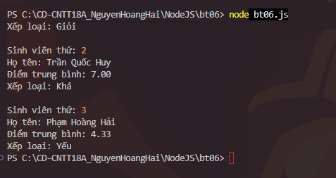

# BÀI 06 - XỬ LÝ ĐIỂM SINH VIÊN BẰNG MODULE NODE.JS

## 1. Mục tiêu

- Xây dựng module xử lý điểm sinh viên.

- Tính điểm trung bình của 3 môn học.

- Xếp loại học tập của sinh viên.

- Sử dụng module.exports để xuất hàm.

- Sử dụng require() để gọi module.

## 2. Cấu trúc chương trình

Bt06/

├── bai06.js

├── xulyDiem.js

├── README.md

└── images/

## 3. Nội dung thực hiện

### File xulyDiem.js

- Hàm tinhDiemTB(): Tính điểm trung bình 3 môn.

- Hàm xepLoai(): Xếp loại học tập.

- Sử dụng module.exports để xuất các hàm.

### File bai06.js

- Sử dụng require('./xulyDiem').

- Tạo dữ liệu 3 sinh viên.

- Tính điểm trung bình.

- Xếp loại và hiển thị kết quả trên Terminal.

## 4. Quy tắc xếp loại

| Điểm trung bình | Xếp loại |

|---|---|

| >= 8 | Giỏi |

| >= 6.5 | Khá |

| >= 5 | Trung bình |

| < 5 | Yếu |

## 5. Các lệnh thực hiện

Cài đặt Node.js nếu máy chưa có.

Kiểm tra phiên bản:

```bash

node -v

npm -v

```

Chạy chương trình:

```bash

node bai06.js
```

## 6. Hình ảnh thực hiện



## 7. Kết quả cuối cùng

- Sinh viên Nguyễn Hoàng Hải: 8.67 - Giỏi.

- Sinh viên Trần Quốc Huy: 7.00 - Khá.

- Sinh viên Phạm Hoàng Hải: 4.33 - Yếu.

Chương trình chạy thành công bằng lệnh:

```bash

node bai06.js

```
